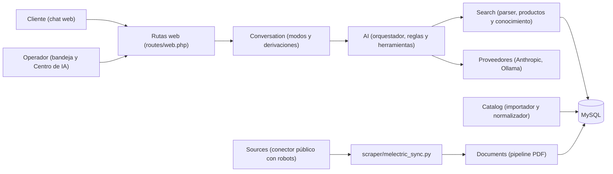
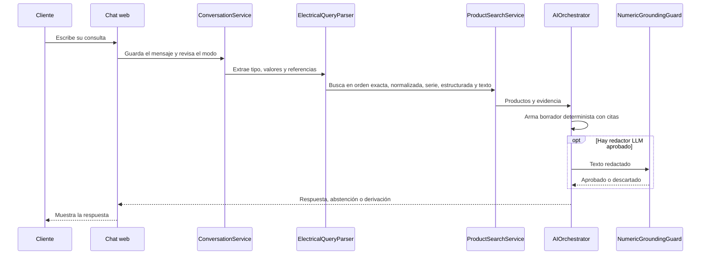
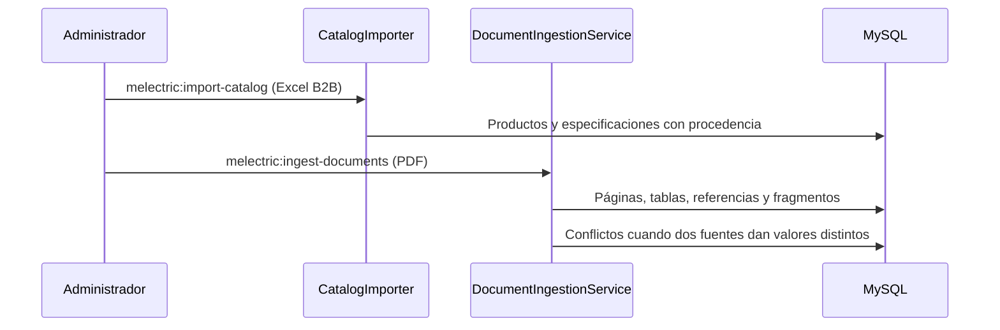
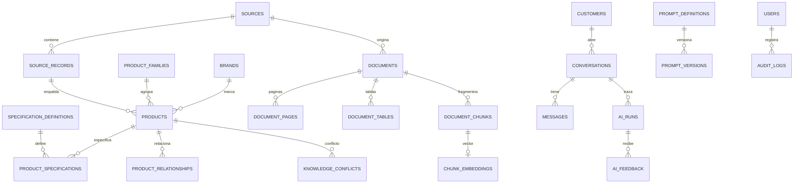

<div align="center">

<br/>

**Plataforma técnico-comercial para MElectric: catálogo con procedencia y asistente que responde solo con evidencia.**


<br/>


</div>


## <a id="contenido"></a> Contenido

[El problema](#el-problema) · [La solución](#la-solución) · [Funcionalidades](#funcionalidades) · [Arquitectura](#arquitectura) · [Flujos de trabajo](#flujos-de-trabajo) · [Modelo de datos](#modelo-de-datos) · [Criterios y decisiones](#criterios-y-decisiones) · [Stack](#stack) · [Estructura del repo](#estructura-del-repo) · [Puesta en marcha](#puesta-en-marcha) · [Pruebas y calidad](#pruebas-y-calidad) · [Despliegue](#despliegue) · [Estado y pendientes](#estado-y-pendientes) · [Licencia y autoría](#licencia-y-autoría)


## <a id="el-problema"></a> El problema

El catálogo técnico de MElectric (productos eléctricos B2B) vive repartido en tres fuentes: un Excel con la lista de productos, PDF de fichas técnicas y el sitio público. Los valores no siempre coinciden entre ellas. Un caso real documentado: el Excel indica 17 A en AC-3 para el DILM17 y el catálogo, en su página 3, indica 18 A.

Cuando un cliente pregunta por una referencia, un asistente que completa huecos con suposiciones es peligroso en este rubro. El repositorio está diseñado alrededor de tres riesgos concretos:

- **Cifras inventadas**: un valor de corriente, tensión o potencia que no está en la fuente.
- **Compatibilidades no verificadas**: afirmar que un relé o accesorio sirve para un contactor solo porque una frase del catálogo lo menciona.
- **Decisiones de cálculo**: kVAR, cortocircuito, selectividad o caída de tensión que requieren un ingeniero, no un chat.

## <a id="la-solución"></a> La solución

MElectric IA es un monolito que ingiere las fuentes autorizadas con su procedencia, normaliza los datos a unidades canónicas y responde con un asistente que **solo afirma lo que tiene como evidencia**. Cuando no la tiene, se abstiene, pregunta o deriva a una persona.

Quién lo usa:

- **Cliente final**: chat público sin cuenta en `/chat`, con respuestas citadas a la fila del Excel o a la página del PDF.
- **Operadores (ventas, soporte)**: bandeja en `/inbox` para seguir conversaciones, tomar el control y responder.
- **Ingeniería**: aprueba las respuestas técnicas con confianza baja antes de que lleguen al cliente, y revisa conflictos y relaciones.
- **Administración y conocimiento**: catálogo, documentos, notas internas, base de conocimiento y Centro de IA (prompts, reglas, trazas y evaluaciones).

Los permisos son de nueve roles con dieciséis permisos (`App\Enums\Role`), verificados en cada ruta con middleware `can:`.

## <a id="funcionalidades"></a> Funcionalidades

<details open>
<summary><b>Chat del cliente</b></summary>

- Conversación sin cuenta, con token aleatorio por conversación.
- Consultas de producto: referencia exacta, alias, familia por tamaño de serie, filtros por especificación y texto completo.
- Respuestas con citas `[n]` a la fila del Excel o a la página del PDF.
- Preguntas de seguimiento con memoria técnica de la conversación («¿y con bobina de 24 Vcc?»).
- Identificación por foto: OCR, lectura de referencias y búsqueda exacta, con la aclaración de que la foto no certifica valores.
- Derivaciones: cálculos a ingeniería y precio o disponibilidad a ventas.
</details>

<details open>
<summary><b>Operación y supervisión</b></summary>

- **Bandeja**: conversaciones con modos `AI_AUTO`, `AI_ASSISTED`, `HUMAN`, `ENGINEERING_REVIEW` y `PAUSED`; respuesta manual, sugerencia del asistente y aprobación de ingeniería.
- **Feedback del operador** sobre cada respuesta (correcta, incorrecta o no identificable) para armar un dataset curado.
- **Catálogo** con procedencia por producto y especificación, y vista de depuración de búsqueda.
- **Conocimiento**: resolver conflictos entre fuentes, revisar especificaciones extraídas y aprobar o rechazar relaciones del catálogo.
</details>

<details open>
<summary><b>Documentos y fuentes</b></summary>

- Pipeline de PDF: páginas, tablas con celdas, referencias detectadas, fragmentos y embeddings. Cada paso queda en un registro de procesamiento.
- Versiones: un documento nuevo deja el anterior como `SUPERSEDED` y solo se citan documentos vigentes.
- Notas de conocimiento internas y otras fuentes (Word, TXT, Markdown, CSV y Excel) con sus validaciones de archivo.
- Sincronización del sitio público con un script de Python, con un clic desde Documentos o por comando.
</details>

<details>
<summary><b>Centro de IA</b></summary>

Resumen de uso, playground con la misma tubería que el chat (con traza completa), prompts versionados (borrador, evaluación, publicación y vuelta atrás), reglas editables con umbral de confianza, trazas (`ai_runs`), evaluaciones con dataset dorado y costos por modelo.
</details>

## <a id="arquitectura"></a> Arquitectura

<p align="center">
  
</p>

**Monolito modular** con Laravel 13, Inertia 3 y React 19. MySQL es la fuente de verdad; el índice vectorial se puede reconstruir. No hay microservicios: los límites son carpetas (`app/Catalog`, `app/Documents`, `app/Search`, `app/AI`, `app/Conversation`, `app/Sources`) y servicios.



Reglas que sostienen el diseño:

- **El LLM solo redacta.** Las cifras, referencias y decisiones salen del borrador determinista con citas; la guardia numérica descarta cualquier redacción que agregue un número o una afirmación de compatibilidad que no está en la evidencia.
- **Ninguna fuente escribe el catálogo sin pasar por el importador.** El sincronizador web compara productos contra el catálogo y los marca como «coinciden» o «faltan», sin escribirlos.
- **Documentos y páginas son datos, no instrucciones.** Los fragmentos con instrucciones incrustadas se marcan y quedan fuera del contexto del modelo.
- **Auditoría inmutable**: `audit_logs` no admite actualizaciones ni borrados.

## <a id="flujos-de-trabajo"></a> Flujos de trabajo

Consulta de un cliente, de punta a punta:



Carga del catálogo y de los documentos:



Los ciclos de vida de conversación y de documento, con el detalle de cada paso, están en `docs/architecture.md`.

## <a id="modelo-de-datos"></a> Modelo de datos

Entidades principales (de las migraciones y los modelos de `app/Models`):



El detalle de índices y el ERD completo están en [`docs/database-erd.md`](docs/database-erd.md).

## <a id="criterios-y-decisiones"></a> Criterios y decisiones

| Decisión | Por qué |
|---|---|
| Monolito modular, sin microservicios | Los límites son carpetas y servicios; un solo despliegue y una sola base |
| MySQL como fuente de verdad; índice vectorial reconstruible | Lo que se pierde en el índice se regenera con `melectric:ingest-documents --reprocess` ([ADR 0001](docs/adr/0001-mysql-fuente-de-verdad-y-vector-reconstruible.md)) |
| LLM solo como redactor, con guardia numérica | El modelo nunca decide cifras ni compatibilidades ([ADR 0002](docs/adr/0002-llm-solo-redactor-con-guardia.md)) |
| Relaciones del catálogo `AUTO_EXTRACTED` hasta que un ingeniero las verifica | Una frase del catálogo no basta para afirmar compatibilidad ([ADR 0003](docs/adr/0003-relaciones-del-catalogo-no-verificadas.md)) |
| Tablas técnicas con mapeos aprobados | Una tabla de contactores se interpreta solo con un mapeo revisado ([ADR 0004](docs/adr/0004-tablas-con-mapeos-aprobados.md)) |
| Unidades canónicas por dimensión | 30 mA (0,03 A) nunca equivale a 30 A; se guarda también el texto crudo |
| Tabla AC-3 válida solo a 380-400 V | Fuera de ese rango el asistente deriva; si no hay fila exacta, toma el tamaño siguiente y lo dice |
| Sin fórmulas de dimensionamiento | Kvar, cortocircuito, selectividad y caída de tensión derivan a ingeniería; la metodología aprobada está pendiente |
| El precio siempre va a ventas | El catálogo con precios requiere credenciales que el sistema no tiene |
| Si el LLM falla, se envía el borrador | El catálogo y la búsqueda no dependen del proveedor de IA |
| Ollama solo en el playground | El 2026-11-09 el modelo local cambió el sentido de una pregunta sin romper la guardia numérica |

Reglas de negocio que no se ven en el código a simple vista:

- Una selección técnica con confianza bajo el umbral del perfil no llega al cliente: queda en `ENGINEERING_REVIEW` hasta que un ingeniero la aprueba, y queda auditado.
- Un documento nuevo que reemplaza a otro deja el anterior como `SUPERSEDED` y descarta sus especificaciones no verificadas. La fecha de subida no decide la vigencia.
- Cuando dos fuentes dan valores distintos para el mismo campo, ambas especificaciones quedan `NEEDS_REVIEW` y el asistente muestra los dos valores con su fuente.

## <a id="stack"></a> Stack

| Capa | Tecnología | Versión |
|---|---|---|
| Lenguaje backend | PHP | `^8.3` (composer.json) |
| Framework | Laravel | `^13.17` |
| Puente SPA | Inertia (`inertiajs/inertia-laravel`) | `^3.3` |
| Interfaz | React · TypeScript | `^19.3.1` · `^7.0.2` |
| Adaptador Inertia (React) | `@inertiajs/react` | `^3.11.0` |
| Estilos | Tailwind CSS | `^4.0.0` |
| Build | Vite | `^8.0.0` |
| Íconos | lucide-react | `^1.70.0` |
| IA | Anthropic SDK (`anthropic-ai/sdk`) · Ollama (embeddings locales) | `^1.3` · configurable |
| Hojas de cálculo | PhpSpreadsheet | `^5.11` |
| Datos | MySQL (producción y desarrollo) · SQLite en memoria (pruebas) | 8+ |
| Pruebas PHP | Pest · PHPUnit | `^4.0` · `^12.5.12` |
| Pruebas front | Vitest · Testing Library · Playwright | `^5.1` · `^16.3.3` · `^1.65.0` |
| Herramientas PDF | poppler-utils (`pdftotext`, `pdfinfo`) | del sistema |
| Sincronizador web | Python 3 (biblioteca estándar) | del sistema |
| OCR | Framework Vision de macOS (binario Swift) | solo macOS |

## <a id="estructura-del-repo"></a> Estructura del repo

```text
app/
  AI/            orquestador, reglas, herramientas, guardia numérica, prompts y proveedores
  Catalog/       importador del Excel, normalizador, extractor de especificaciones y unidades
  Conversation/  conversaciones, modos, derivaciones y aprobación de ingeniería
  Documents/     pipeline PDF, tablas, referencias, versiones y notas de conocimiento
  Search/        parser de consultas, búsqueda de productos y de conocimiento, embeddings
  Sources/       conector público con robots, lista blanca y guardia SSRF
  Vision/        identificación por foto (OCR y búsqueda exacta)
  Engineering/   datos requeridos por tipo de producto y derivación a ingeniería
  Enums/         roles (Role) y permisos
  Models/        modelos Eloquent (productos, documentos, conversaciones, trazas, auditoría)
resources/js/pages/  pantallas Inertia: Ai, Auth, Chat, Documents, Inbox, Knowledge, Products, Search, Sources
routes/web.php       rutas con middleware de permisos
scraper/             sincronizador del sitio público en Python y sus pruebas
bin/                 OCR de macOS (ocr-macos.swift)
docs/                arquitectura, ERD, seguridad, pruebas, despliegue, fuentes y ADR
tests/               Pest (Feature, Unit, AI) · Playwright (e2e)
```

## <a id="puesta-en-marcha"></a> Puesta en marcha

Requisitos: PHP 8.3 o superior, Composer 2, Node 22 o superior, MySQL 8, `poppler-utils` para los PDF y, para la identificación por foto en local, macOS con Xcode (para compilar el OCR).

```bash
composer install && npm install
cp .env.example .env && php artisan key:generate   # completar DB_* y DEV_USERS_PASSWORD
php artisan migrate && php artisan db:seed && php artisan storage:link
php artisan melectric:import-catalog               # Excel B2B V2 + imágenes de línea
php artisan melectric:ingest-documents             # PDF públicos del sitio
php artisan melectric:sync-web                     # sitio público con el script de Python
swiftc -O bin/ocr-macos.swift -o bin/ocr-macos     # OCR local (solo macOS)
npm run build && php artisan serve --port=8077
```

- Operadores en `/login`, con usuarios de desarrollo (`admin@`, `ingenieria@`, `ventas@`, `conocimiento@` en el dominio de prueba del repo). La contraseña sale de `DEV_USERS_PASSWORD`, nunca del código.
- Chat del cliente en `/chat`.

<details>
<summary><b>Variables de entorno principales (nombres)</b></summary>

| Variable | Para qué sirve |
|---|---|
| `DB_*` | Conexión a MySQL |
| `DEV_USERS_PASSWORD` | Contraseña de los usuarios de desarrollo (solo en `local`) |
| `ANTHROPIC_API_KEY` | Proveedor de redacción y visión |
| `AI_EMBEDDINGS_PROVIDER` | `ollama` por defecto; `fake` solo en pruebas |
| `AI_WRITER_PROVIDERS` | Proveedores aprobados para redactar lo que ve el cliente (por defecto `anthropic`) |
| `SYNC_BASE_URL` · `SYNC_ALLOWED_HOSTS` | Sitio a sincronizar y dominios permitidos |
| `FILESYSTEM_DISK` | Disco de archivos privados (`storage/app/private`) o S3 compatible |

Los valores reales nunca van al repositorio: solo las plantillas `.env.example`.
</details>

Comandos útiles:

| Comando | Para qué |
|---|---|
| `php artisan melectric:import-catalog [excel] [--images=]` | Importa o actualiza el catálogo (idempotente; informa nuevos, actualizados, sin cambios y fallidos) |
| `php artisan melectric:ingest-documents [dir] [--reprocess]` | Pipeline documental de PDF |
| `php artisan melectric:sync-web [--base=URL]` | Sincroniza el sitio con el script de Python |
| `php artisan melectric:eval [--llm]` | Dataset dorado del asistente con métricas de abstención |

## <a id="pruebas-y-calidad"></a> Pruebas y calidad

| Capa | Comando | Qué cubre |
|---|---|---|
| Backend | `./vendor/bin/pest` | Unidades y rangos, normalizador, extractor, búsqueda, orquestador, guardia numérica, PDF real, SSRF, permisos y prompts con vuelta atrás |
| Tipos | `npm run typecheck` | TypeScript (`tsc --noEmit`) |
| Frontend | `npm test` | Vitest (componentes de mensaje y confianza) |
| Build | `npm run build` | Compilación de producción con Vite |
| E2E | `npx playwright test` | Flujos críticos en navegador (`tests/e2e`) |
| Asistente | `php artisan melectric:eval [--llm]` | Dataset dorado en `tests/AI/evals/golden.json` |
| Sincronizador | `cd scraper && python3 -m unittest test_melectric_sync.py` | Texto sin menú ni pie, JSON-LD sin precios, SSRF y lista blanca |

Las pruebas usan SQLite en memoria y proveedores `fake` (forzado en `phpunit.xml`): nunca tocan MySQL ni llaman a una IA real.

Las métricas del dataset dorado son: `pass_rate`, `correct_answer_rate`, `false_answer_rate`, `correct_abstention_rate`, `unnecessary_abstention_rate` y `false_confident_technical` (respuesta técnica fallida con confianza igual o mayor a 0,8, la más peligrosa). El dataset lo escribió el mismo equipo que hizo el sistema: sirve como regresión, no como medición independiente. Conviene sumar casos reales de la bandeja.

## <a id="despliegue"></a> Despliegue

No hay Dockerfile ni workflow de despliegue en el repositorio; el despliegue está documentado en [`docs/deployment.md`](docs/deployment.md) como pasos manuales:

```bash
composer install --no-dev --optimize-autoloader
npm ci && npm run build
php artisan migrate --force && php artisan db:seed --force
php artisan storage:link
php artisan melectric:import-catalog <excel> --images=<carpeta>
php artisan melectric:ingest-documents <carpeta-pdf>
php artisan melectric:crawl-public
php artisan config:cache route:cache view:cache
```

- Almacenamiento: `storage/app/private` (fuentes y documentos) en disco o S3 compatible. Las imágenes de línea van al disco público.
- Respaldos: base `melectric_ia` con `mysqldump` diario y `storage/app/private`. El índice vectorial no necesita respaldo: se regenera.
- Salud: `/up` del framework. Pendiente según la documentación: un endpoint autorizado que revise base de datos, almacenamiento, proveedor de IA y embeddings.
- Modos de falla: sin LLM responde con el borrador determinista; sin embeddings usa texto completo; si el crawler cae, los datos guardados no se tocan.

## <a id="estado-y-pendientes"></a> Estado y pendientes

Último commit en la rama local: **2026-11-09** (`0307bb8`). No hay evidencia en el repo de un despliegue productivo: **no verificado**.

Bloqueos reales documentados al 2026-11-09:

- La `ANTHROPIC_API_KEY` del entorno devolvió 401; el sistema funciona sin LLM con respuestas deterministas.
- El catálogo con precios (`/Galeria`) requiere credenciales que el proyecto no tiene.
- El OCR local solo corre en macOS. Para producción en Linux falta conectar tesseract o un modelo de visión con credenciales válidas.
- La primera sincronización del sitio encontró un PDF roto (404) y 6 rutas fuera de alcance; no se publicaron productos en JSON-LD.

Pendientes documentados: `EngineeringCalculationService` con metodología aprobada, endpoint de salud autorizado y casos reales para el dataset de evaluación. El estado detallado está en la sección «Estado» de `docs/architecture.md`.

## <a id="licencia-y-autoría"></a> Licencia y autoría

Desarrollado por el **Ing. Santiago Abasto**.


Repositorio propietario de MElectric. No hay archivo `LICENSE` en la raíz. El `composer.json` conserva la licencia MIT del esqueleto de Laravel, sin una licencia propia declarada: **no verificado** si aplica al código del proyecto. La autoría del código no se declara en el repositorio.
