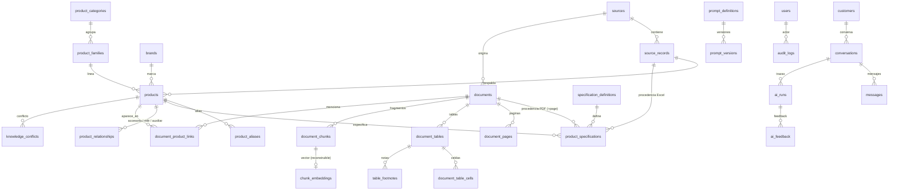

# Modelo de datos (ERD)

Índices pensados por uso: `products.internal_code` (único), `normalized_reference`, `base_reference`, `series`,
`(category_id, family_id)`, FULLTEXT `(reference, description)`; `product_specifications (definition_id, value)`,
`(definition_id, value_text)`, `(product_id, definition_id)`; `documents.sha256` (único); `document_chunks` FULLTEXT;
`conversations (status, mode)`, `last_message_at`; `messages (conversation_id, created_at)`; `ai_runs.created_at`.
